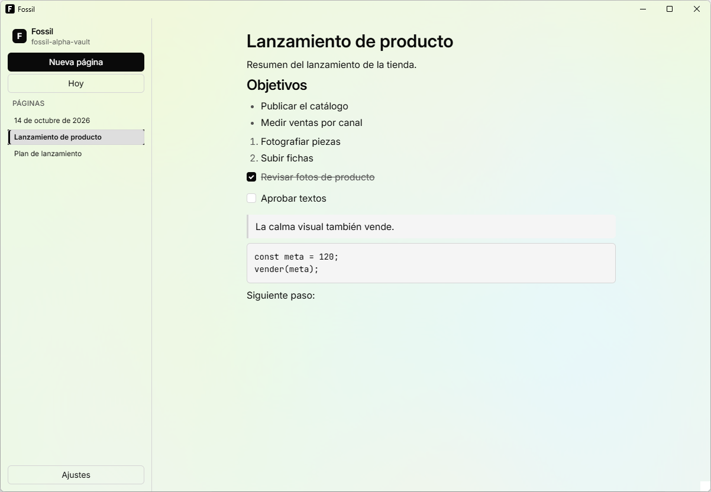
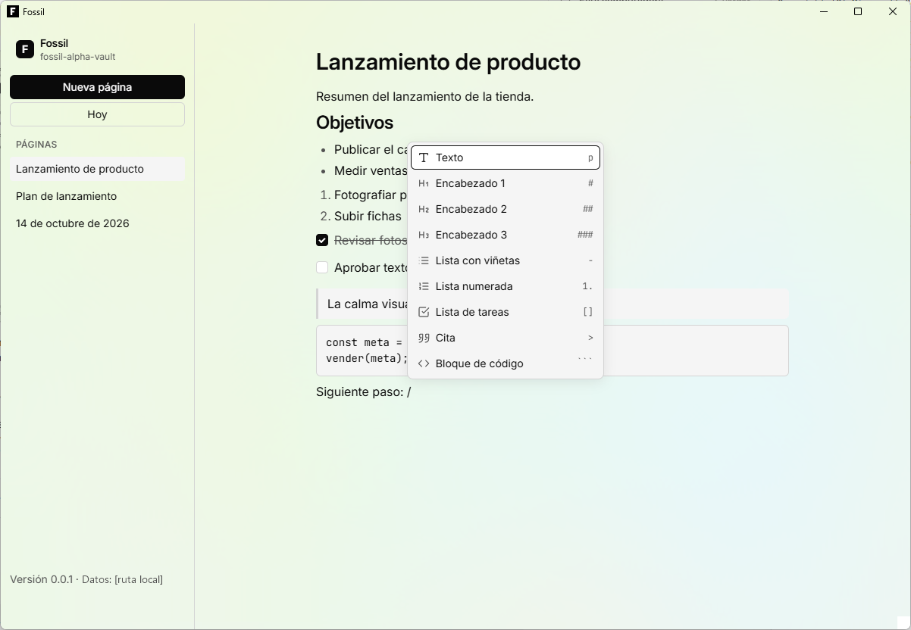
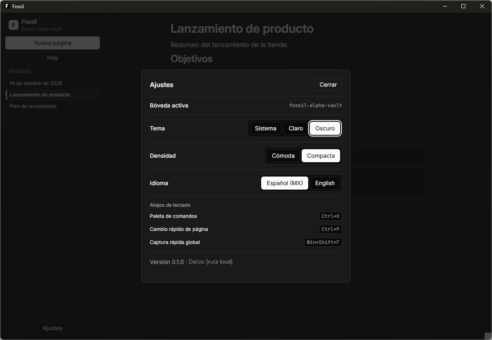

<h1 align="center">Fossil</h1>

<p align="center">
  <b>El espacio de trabajo de escritorio para equipos de marketing, e-commerce, datos y redes.</b><br>
  Notas, tareas, contenido con aprobaciones, ventas y anuncios en un solo grafo de páginas.<br>
  Local primero, ligero y con IA que tú eliges.
</p>

<p align="center">
  
  
  
  
</p>

<p align="center">
  
</p>

## Qué es Fossil

Un equipo de marketing trabaja hoy en cinco o seis herramientas que no se hablan: notas, tareas,
calendario de publicaciones, aprobaciones del cliente, paneles de anuncios, la tienda en línea y la
hoja de cálculo del reporte mensual. Responder "¿qué creativo vendió más y dónde se usó?" cuesta una
tarde.

En Fossil **todo es una página**: una nota, una tarea, una publicación, una campaña, un creativo, un
producto o un pedido. Las páginas tienen tipo, campos y enlaces entre sí, así que esa pregunta se
vuelve una consulta. Fossil cierra el ciclo completo en una sola app:

```
idea → contenido → aprobación → publicación → anuncio → venta → aprendizaje
```

Tu Espacio es una carpeta en tu computadora, funciona sin internet y cada página se guarda también
como Markdown. La IA usa tus propias claves de API, modelos locales o los CLIs de IA que ya tengas
instalados; nunca un servidor nuestro. La explicación completa está en
[`docs/OVERVIEW.md`](docs/OVERVIEW.md).

## Qué hace hoy

Fossil está en **alpha** (0.1). Esto ya funciona en la app:

| | |
|---|---|
| **Espacios locales** | Crea uno o abre una carpeta existente; los recientes aparecen al iniciar |
| **Editor de bloques** | Párrafos, encabezados, listas, tareas, citas y código; menú `/` y atajos de Markdown al escribir |
| **Bitácora** | **Hoy** abre la nota del día y la crea si no existe |
| **Copia en Markdown** | Cada página se guarda también como `.md` con frontmatter, legible por cualquier editor |
| **Exportar Markdown** | Descarga cualquier página como archivo `.md` |
| **Ajustes** | Tema claro, oscuro o del sistema; densidad cómoda o compacta; español o inglés |
| **Guardado continuo** | No hay botón de guardar; nada se pierde al cerrar |

En revisión para la siguiente versión: búsqueda de texto completo, enlaces `[[página]]` y
etiquetas, **Enlazada desde**, paleta de comandos `Ctrl+K`, esquemas con `Tab`, tablas y avisos,
y proveedores de IA (Anthropic, OpenAI, Gemini, Ollama y CLIs locales).

<table>
  <tr>
    <td width="50%"><br><sub>Escribe <code>/</code> para insertar cualquier bloque.</sub></td>
    <td width="50%"><br><sub>Ajustes en tema oscuro, con densidad compacta.</sub></td>
  </tr>
</table>

## Qué viene

| Área | Lo principal | Release |
|---|---|---|
| Conocimiento | Búsqueda, enlaces y etiquetas, captura rápida global, pestañas y paneles | R1 |
| IA | Chat con el contexto de la página, IA sobre la selección; después, un agente con las herramientas de la app | R1–R2 |
| Trabajo | Tipos propios con campos, vistas de tabla, tablero y calendario, tareas con recordatorio | R2 |
| Equipo | Edición en vivo, comentarios, roles e historial | R3 |
| Contenido | Marca, campañas, publicaciones con versiones por red, parrilla, aprobaciones con enlace para el cliente | R4 |
| Comercio y datos | Tienda, Meta Ads, Google Ads, TikTok Ads y GA4 conectados; rentabilidad, atribución, creativos, reportes | R5 |
| Publicación | Publicaciones aprobadas que salen solas a la hora elegida | R6 |

El catálogo completo, por categoría, está en [`docs/FEATURES.md`](docs/FEATURES.md); la versión
breve, en [`ROADMAP.md`](ROADMAP.md).

## Principios

- **Un solo grafo.** Cualquier página se enlaza y se consulta desde cualquier otra.
- **Local primero, sin encierro.** Tus datos viven en tu disco; exportas Markdown cuando quieras.
- **Teclado primero.** `Ctrl+K` llega a cualquier acción, y esas acciones son las mismas que usan la IA y el MCP.
- **IA bajo tu control.** Ves qué modelo responde y cuánto cuesta; nada externo o destructivo pasa sin confirmación.
- **Ligera, y medida.** CI mide cada cambio. Hoy: instalador de 1.1 MB, arranque de 0.2–0.6 s, ~158 MB de RAM en reposo ([`docs/PERFORMANCE.md`](docs/PERFORMANCE.md)).

## Bajo el capó

| Capa | Tecnología |
|---|---|
| App | Tauri 2 (Rust + WebView2), solo Windows |
| Interfaz | React 19, TypeScript, Vite, Tailwind v4 |
| Editor | TipTap 3 con Yjs; bloques con ID propio |
| Datos locales | SQLite (WAL, FTS5) con CRDT (yrs); copia en Markdown |
| Contrato entre capas | Tipos TypeScript generados desde Rust (tauri-specta) |
| IA | Router propio en Rust; proveedores por API, locales o CLIs instalados |
| Nube (R3+) | Supabase y Hocuspocus para sincronizar equipos |

Detalle en [`docs/ARCHITECTURE.md`](docs/ARCHITECTURE.md).

## Empezar

**Usar Fossil.** Descarga el instalador de la [última versión](https://github.com/jairbonillacan-cmd/fossil-app/releases/latest). Es una alpha sin firma de código, así que Windows SmartScreen pedirá confirmación.

**Compilar desde el código.** Necesitas Windows 11, Rust (MSVC), Visual Studio Build Tools con C++,
Node.js 22+ y pnpm ([`docs/DEVELOPMENT.md`](docs/DEVELOPMENT.md)).

```powershell
git clone https://github.com/jairbonillacan-cmd/fossil-app.git
cd fossil-app
pnpm install
pnpm dev        # abre Fossil en modo desarrollo
pnpm check      # lint, tipos y tests de TypeScript
```

> [!IMPORTANT]
> **Estado: alpha.** Fossil ya sirve como app de notas local, pero todavía no tiene búsqueda,
> tipos, vistas ni nada de equipo, contenido o comercio. Los formatos internos pueden cambiar entre
> versiones; la copia en Markdown es tu respaldo. Lo que funciona y lo que falta, medido:
> [`docs/STATUS.md`](docs/STATUS.md). Si algo falla, abre un issue con tu versión de Windows,
> los pasos y una captura ([`SUPPORT.md`](SUPPORT.md)).

## Documentación

Todo empieza en [`docs/README.md`](docs/README.md), ordenado por quién lo lee: personas usuarias,
contribuidores, agentes de IA y mantenedores.

## Contribuir

Lee [`CONTRIBUTING.md`](CONTRIBUTING.md). Si eres un agente de IA, empieza por [`AGENTS.md`](AGENTS.md).
Este proyecto sigue un [código de conducta](CODE_OF_CONDUCT.md).

## Seguridad y privacidad

Fossil no tiene telemetría ni cuentas obligatorias. Qué guarda y qué sale de tu computadora:
[`docs/PRIVACY.md`](docs/PRIVACY.md). Para reportar una vulnerabilidad, sigue
[`SECURITY.md`](SECURITY.md) y no abras un issue público.

## Licencia

Fossil es software libre bajo la [GNU Affero General Public License v3.0](LICENSE) o, a tu elección,
cualquier versión posterior (`AGPL-3.0-or-later`). Si modificas Fossil y lo ofreces a otros, también por red, debes publicar
tu código bajo la misma licencia. Las fuentes y otros recursos incluidos conservan su propia
licencia ([`ATTRIBUTION.md`](ATTRIBUTION.md)).
